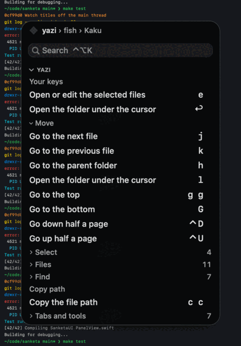
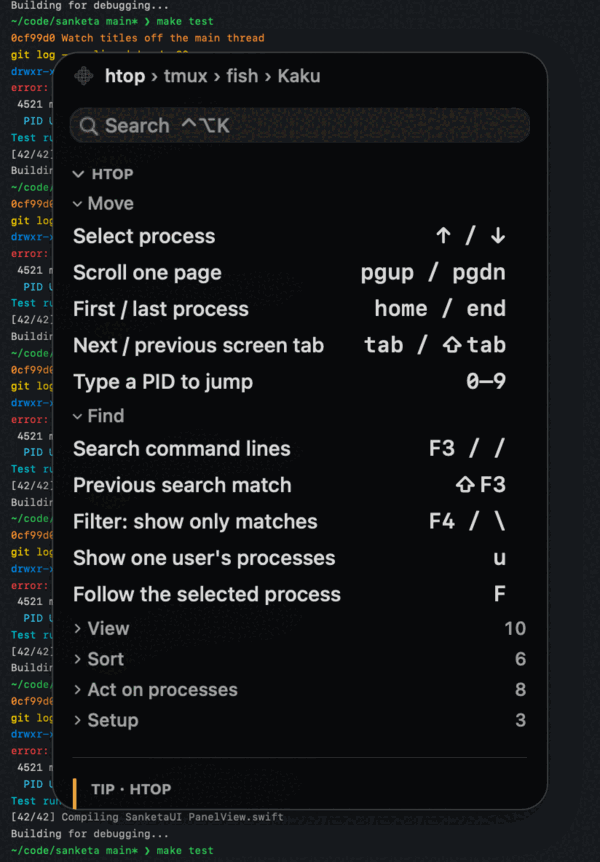
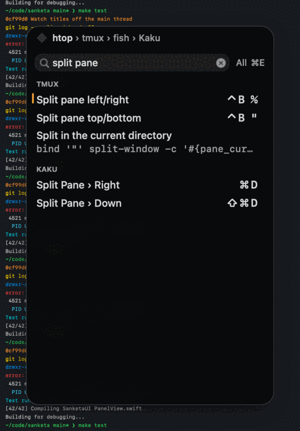
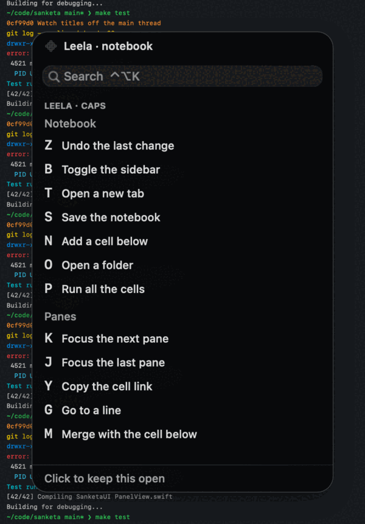
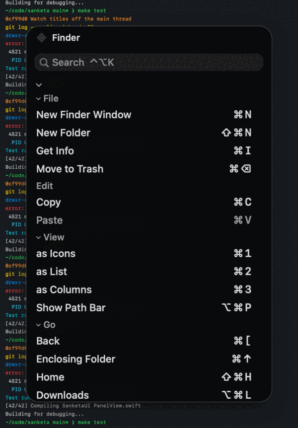

# Sanketa

Sanketa is a Mac menu-bar app. It shows the keys of the program that you use now, in a small glass panel.

[](https://github.com/vedicreader/sanketa/releases/latest/download/Sanketa.zip) [](https://github.com/vedicreader/sanketa/actions/workflows/build.yml)

<!-- hero.gif shows drawn panels. To use a real screen recording, follow docs/media/SHOTLIST.md and replace docs/media/hero.gif. -->


The name is Sanskrit for "hint" or "signal".

## What you get

| | |
|---|---|
|  | **Keys for each layer.** Run htop in tmux in fish, and the panel shows the htop keys first. Then it shows your tmux keys and the fish tips. |
|  | **Search all keys.** Press ⌃⌥K and type a word. Press Return to copy the command. |
|  | **Hold a combo to see its keys.** Hold Caps, ⌥ or ⌘. The panel shows what that combo does in the app in front. |
|  | **Menu keys of any app.** Outside a terminal, the panel shows the menu keys of the app in front. |

The panel does not take the focus from your terminal. It takes the focus only when you search.

## Install

You need macOS 26 on a Mac with Apple Silicon.

```sh
brew install --cask vedicreader/tap/sanketa
```

Or click the Download button above. Unzip the file, and move `Sanketa.app` to Applications.

## First use

1. Open Sanketa. A ⌘ symbol shows in the menu bar.
2. Allow Accessibility. Open System Settings, go to Privacy & Security, then Accessibility, and turn on Sanketa. Sanketa uses this permission to read the menu keys and window titles of other apps. It sees which modifier keys you hold. It does not record the other keys that you press.
3. Go to your terminal or an app. The panel shows its keys.

## Keys

| Keys | What they do |
|---|---|
| ⌃⌥K | Show the panel and start a search |
| ↑ ↓ | Move the selection in search |
| Return | Copy the command, or open the result |
| Tab | Go to the layer list |
| ⌘E | Change the search scope: All, Shortcuts or Vault |
| Esc | Stop the search, and give the focus back |
| Hold Caps, ⌃, ⌥ or ⌘ | Show the keys of that combo |

You can change the search key from the panel. See "Change a key" in the guide.

## More

- [Guide](docs/guide.md): the menu, search, the vault, held keys, settings, terminals, packs, remote hosts, privacy and limits.
- [Packs](docs/packs.md): write a pack of keys for a program that Sanketa does not know.
- [Develop Sanketa](docs/development.md): build from source, tests and releases.
- [Contributing](CONTRIBUTING.md): rules for a change.
